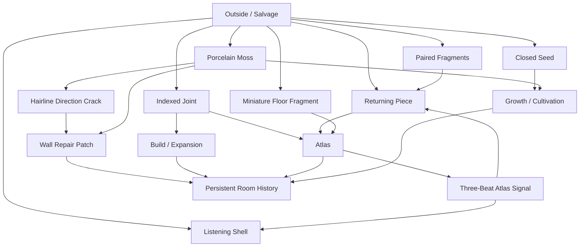

# VQ2 Core World Seeds & Relationship Network v0.1

> Date: 2026-08-25  
> Status: RESEARCH / PROPOSED — CONTENT ECOLOGY, NOT IMPLEMENTATION AUTHORIZATION  
> Scope: prune the broad world-content catalog into a small high-leverage constellation of recurring objects, anomalies, traces, and Atlas phenomena  
> Parent documents: `VQ2_WORLD_CONTENT_CATALOG_V0_1_2026-08-25.md`, `VQ2_LOW_VERB_HIGH_DISCOVERY_CONTENT_ARCHITECTURE_2026-08-25.md`

---

# 0. Purpose

The project does **not** need dozens of independent mechanics to feel deep.

The preferred model is:

> **Few verbs, few core content families, many changing relationships.**

The player should quickly understand basic actions such as retrieve, inspect, place, keep, cultivate, build, repair, and observe.

Long-term novelty should come from:

- old objects gaining new meaning;
- objects reacting to one another;
- the room itself changing;
- problems leaving history instead of resetting cleanly;
- Atlas revealing relationships that were already present but previously invisible;
- one content node participating in several systems.

This document therefore selects **10 proposed core world seeds** from the broader catalog and maps how they can form a reusable ecology.

The goal is not to make every seed mandatory.

The test is:

> If only these ten kinds of things existed, could the room already feel alive, mysterious, persistent, and capable of surprising the player without requiring many separate minigames?

Current answer: **yes, potentially**.

---

# 1. The 10 proposed core world seeds

These are not ranked by rarity or implementation order. Each serves a different design function.

## Seed 1 — The Returning Piece

**Role:** first proof that an object can obey a direction the player cannot explain.

Tags: `[Salvage][Research][Display][Atlas clue][Anomaly interaction]`

Basic identity:

- smooth ceramic-like fragment;
- ordinary enough to place casually on a desk;
- if rotated away and left alone, it slowly returns toward the same unseen orientation.

Why it deserves core status:

- very simple object;
- requires no bespoke control scheme;
- can live visibly in the room for a long time;
- can be understood differently at several progression stages.

Meaning progression:

`strange desk object`

→ `repeatable directional behavior`

→ `several room phenomena share that direction`

→ `Atlas later responds along the same relation`

→ `the player reinterprets an object found much earlier`

Core principle demonstrated:

> **Knowledge can upgrade an old object without changing the object.**

---

## Seed 2 — Closed Seed

**Role:** first proof that recovered things can have a life history rather than an immediate use.

Tags: `[Salvage][Research][Cultivation][Display][Long change]`

Basic identity:

- looks vaguely seed-like but not clearly botanical;
- initially inert;
- may remain closed for a meaningful period;
- can respond to a room condition rather than a conventional fertilizer recipe.

Why it deserves core status:

- introduces waiting/anticipation without creating a stamina or farming chore;
- gives the player a reason to notice tomorrow what they placed today;
- teaches that not every salvage result should be immediately converted into value.

Important guardrail:

> The Closed Seed is not the start of a conventional crop economy.

Its main value is uncertainty and transformation.

---

## Seed 3 — Porcelain Moss

**Role:** first content family that is simultaneously useful, beautiful, and capable of becoming a problem.

Tags: `[Salvage][Research][Cultivation][Build/Repair][Display][Anomaly]`

Basic identity:

- spreads like moss;
- hardens like ceramic;
- visually compatible with the handmade / matte / architectural-model art direction;
- difficult to classify as plant, material, or organism.

Why it deserves core status:

It can participate in several very different outcomes without adding a new core verb:

- cultivate it;
- display it;
- use it as repair material;
- allow it to spread;
- remove/contain it if it becomes disruptive;
- preserve a grown patch as part of the room's history.

This is the strongest current example of **relationship density**.

---

## Seed 4 — Indexed Joint

**Role:** first recovered thing that is obviously useful for construction, proving that salvage can physically grow the room rather than only produce curiosities.

Tags: `[Salvage][Build][Atlas][Expansion potential]`

Basic identity:

- compact connector with several indexed positions;
- seems mechanical but not like generic hardware-store scrap;
- one position fits a specific world interface with unnatural precision.

Why it deserves core status:

The content catalog needs at least one object whose usefulness is immediately legible.

If every recovered thing is mysterious, the world becomes emotionally flat in the opposite direction: everything is equally unknowable.

Indexed Joint creates contrast:

> Some things are strange because we do not understand them. Some things are satisfying because they clearly let us build.

It also prevents construction from becoming a generic wood/stone/metal resource system.

---

## Seed 5 — Listening Shell

**Role:** ambient bridge between living content and Atlas phenomena.

Tags: `[Salvage][Research][Cultivation/Ambiguous life][Display][Atlas]`

Basic identity:

- small shell-like object/organism;
- usually quiet and mostly closed;
- occasionally opens or changes posture during certain room or Atlas states.

Why it deserves core status:

It turns invisible system activity into world behavior.

Instead of showing:

`ATLAS SIGNAL DETECTED`

in UI, the player may first notice:

> “That shell opened again.”

Later they learn that its timing is not random.

This creates observation and pattern recognition without new controls.

---

## Seed 6 — Hairline Direction Crack

**Role:** first proof that the **room itself** can become content.

Tags: `[Event][Research][Repair][Atlas clue][Persistent trace]`

Basic identity:

- small wall crack;
- shape/direction does not follow ordinary structural stress;
- visually readable but not catastrophic.

Why it deserves core status:

The room should not be a neutral container holding interesting objects.

The room must sometimes become the interesting object.

This seed supports:

- investigation;
- a choice to repair or temporarily observe;
- relation to direction-based clues;
- creation of a permanent historical trace.

Emotional target:

`odd -> curious -> worth dealing with`

not:

`horror emergency`.

---

## Seed 7 — Wall Repair Patch

**Role:** first explicit proof that resolving a problem can make the room **more historically rich**, not simply return it to factory-new condition.

Tags: `[Repair][Display/Memory][World history][Future interaction surface]`

Basic identity:

- visible repair where the Hairline Crack once existed;
- attractive, intentional, and physically readable;
- potentially created from a material such as Porcelain Moss, but exact recipe is not frozen.

Why it deserves core status:

This seed is not primarily an item. It is a **memory object embedded in architecture**.

It establishes a crucial long-term rule:

> **Before -> After -> History**

not merely:

> **Broken -> Fixed -> Reset**.

Future content may react differently to repaired surfaces, giving old incidents mechanical relevance without requiring a new UI history log.

---

## Seed 8 — Three-Beat Atlas Signal

**Role:** first repeatable phenomenon suggesting that Atlas behavior contains structured information rather than random effects.

Tags: `[Atlas][Observation][Research][Object relationships]`

Basic identity:

- a simple repeated three-beat response;
- initially presented as sound/motion/material response rather than a decoded message;
- can be independently echoed by selected world objects.

Why it deserves core status:

A repeated signal is one of the cheapest ways to make players form hypotheses.

The same three-beat structure can appear in several media:

- Atlas movement;
- Listening Shell behavior;
- vibration in a recovered plate/object;
- brief room hum;

The player then discovers a relationship rather than receiving exposition.

Important rule:

> Do not turn the three-beat signal into a rhythm minigame by default.

Its value is recognition, not dexterity.

---

## Seed 9 — Paired Fragments

**Role:** first delayed relationship discovery.

Tags: `[Salvage][Research][Display][Delayed discovery][Potential Atlas/Outside clue]`

Basic identity:

- Fragment A appears alone and seems only mildly interesting;
- Fragment B may be found much later;
- when both occupy the same room, they react.

Possible reactions:

- turn;
- warm;
- align;
- pulse;
- separate;
- change surface state.

Why it deserves core status:

This seed creates one of the most important long-term feelings the project can have:

> **“Wait — I remember that old thing.”**

It rewards memory rather than mechanical mastery.

Guardrail:

Not every pair should ultimately point to Atlas. At least some relationship content should deepen the Outside / room ecology independently so that Atlas does not become the explanation for everything.

---

## Seed 10 — Miniature Floor Fragment

**Role:** first physical clue that another room-like spatial structure may exist before Atlas clearly reveals a stranger room.

Tags: `[Salvage][Research][Display][Atlas][World mystery]`

Basic identity:

- tiny architectural slab;
- proportions resemble a floor section;
- does not match the player's own room;
- initially could be interpreted as a model, broken object, or meaningless shape.

Why it deserves core status:

It prepares the player for the later Atlas revelation without spoiling it.

Possible meaning progression:

`odd miniature architecture`

→ `repeated geometry appears in Atlas smear`

→ `foreign furniture becomes recognizable`

→ `player realizes the old fragment may have represented or come from a room-like structure`

It does **not** prove the Fracture hypothesis, System hypothesis, or origin of the fragment.

---

# 2. Core relationship network

The strongest version of this content set is not ten parallel collectibles.

It is a network.

This diagram is conceptual, not a locked dependency graph.

The important design observation is that **one content node should often touch several loops at once**.

---

# 3. The five strongest relationship chains

These chains demonstrate why the selected seeds have more value than isolated loot.

## Chain A — Object -> Anomaly -> Atlas reinterpretation

`Returning Piece`

→ player notices unexplained orientation

→ later `Hairline Direction Crack` points along a suspiciously similar relation

→ later Atlas develops directional response

→ player reinterprets two old phenomena as possibly connected

No new input method is required.

The progression is almost entirely **knowledge progression**.

---

## Chain B — Problem -> Growth -> Repair -> History

`Hairline Direction Crack`

→ investigate / choose to resolve

→ `Porcelain Moss` proves useful as a strange repair medium

→ wall becomes `Wall Repair Patch`

→ patch remains visible permanently

→ future objects/growth may react differently to repaired surfaces

This transforms an incident into a new piece of the room rather than a temporary quest.

---

## Chain C — Signal -> Living response -> Pattern recognition

`Three-Beat Atlas Signal`

→ player hears/sees repeated Atlas behavior

→ `Listening Shell` opens at matching moments

→ later other content may echo the same cadence

→ player concludes the shell is responding to something external or structural

The shell therefore becomes a world-native sensor without being presented as a gadget.

---

## Chain D — Inert object -> delayed relationship

`Paired Fragment A`

→ displayed for days/weeks

→ `Paired Fragment B` eventually appears

→ both react

→ old object becomes newly important

This is one of the purest examples of `LOW VERB / HIGH DISCOVERY`.

---

## Chain E — Strange miniature -> spatial echo -> stranger room

`Miniature Floor Fragment`

→ player does not understand scale/origin

→ Atlas later produces incomplete spatial smear

→ repeated geometry begins to look architectural

→ foreign furniture becomes recognizable

→ moving resident confirms another inhabited room

→ old fragment is reinterpreted again

This chain allows Atlas's largest revelation to be prepared by physical world evidence rather than a surprise UI feature unlock.

---

# 4. Coverage matrix

`● = strong relationship`, `○ = possible/secondary relationship`.

| Core seed | Salvage | Research | Growth | Build/Repair | Atlas | Anomaly/Event | Display/Memory | Long reinterpretation |
|---|---:|---:|---:|---:|---:|---:|---:|---:|
| Returning Piece | ● | ● |  |  | ● | ○ | ● | ● |
| Closed Seed | ● | ● | ● |  | ○ | ○ | ● | ● |
| Porcelain Moss | ● | ● | ● | ● | ○ | ● | ● | ● |
| Indexed Joint | ● | ○ |  | ● | ● |  | ○ | ○ |
| Listening Shell | ● | ● | ○ |  | ● | ○ | ● | ● |
| Hairline Direction Crack |  | ● |  | ● | ○ | ● | ● | ● |
| Wall Repair Patch |  | ○ | ○ | ● |  | ○ | ● | ● |
| Three-Beat Signal |  | ● |  |  | ● | ● | ○ | ● |
| Paired Fragments | ● | ● |  |  | ○ | ○ | ● | ● |
| Miniature Floor Fragment | ● | ● |  |  | ● |  | ● | ● |

The purpose of this table is not to maximize every column.

A seed becomes suspicious if it has only one useful relationship and no later reinterpretation potential.

---

# 5. Why these ten are stronger than a larger loot table

A conventional loot table might provide:

- 15 common materials;
- 8 rare materials;
- 5 decorative collectibles;
- 4 Atlas parts;
- 10 plant seeds.

That creates quantity but weak memory.

The selected constellation instead creates distinct questions:

- Why does this piece turn back?
- Why has this seed still not opened?
- Is this moss alive or construction material?
- Why does this connector fit perfectly?
- Why did the shell open right now?
- Why is the crack pointing that way?
- Why is the repair still visible?
- Why does Atlas repeat that same rhythm?
- Why did these two unrelated fragments react?
- Why does this tiny floor look like architecture?

These questions are more valuable than rarity labels because they motivate observation and memory.

---

# 6. Complexity guardrails

The selected seeds should **not** become ten separate systems.

They should mostly reuse the same verbs:

- retrieve;
- inspect;
- place;
- keep;
- observe;
- cultivate;
- build;
- repair.

Do not automatically add:

- Returning Piece orientation minigame;
- Closed Seed watering meter;
- Porcelain Moss farming dashboard;
- Listening Shell rhythm game;
- Crack repair tracing minigame;
- Paired Fragment combination puzzle UI;
- Miniature Floor Fragment lore screen.

A new mechanic is justified only when it opens a broad reusable family of future content.

The player's **understanding** should become more complex faster than the player's **controls**.

---

# 7. Keep mystery distributed — avoid Atlas monoculture

Atlas is a major long-term object, but it must not become the answer to every strange thing.

Recommended content balance:

### Atlas-linked

- Returning Piece directional relation;
- Listening Shell response;
- Three-Beat Signal;
- Miniature Floor Fragment;
- some Indexed Joint functionality.

### Room / Outside ecology independent of Atlas

- Closed Seed life cycle;
- Porcelain Moss growth/repair behavior;
- some Paired Fragment relationships;
- repair traces;
- edge/boundary adaptation;
- future object-object reactions.

Rule:

> The player should discover a larger world, not merely a large machine.

---

# 8. What the room can feel like with only these ten seeds

Even without adding many more systems, a long-lived room could accumulate:

- a Returning Piece on one resident's desk;
- a Closed Seed that has finally changed after days of inactivity;
- Porcelain Moss cultivated in one controlled patch and fossilized in another;
- an Indexed Joint visibly incorporated into Atlas or an edge structure;
- a Listening Shell kept near a workstation because its behavior is useful to notice;
- one repaired wall patch from an old crack event;
- an old Paired Fragment the player nearly forgot about;
- a Miniature Floor Fragment displayed because nobody yet knows what it is;
- Atlas occasionally repeating the three-beat pattern;
- physical evidence that the room has been used, repaired, studied, and changed.

This is already substantially more alive than a room whose progression is represented mainly through money, furniture price, or level number.

---

# 9. Current proposed cut

From the broad catalog, the current strongest **core constellation** is:

1. Returning Piece
2. Closed Seed
3. Porcelain Moss
4. Indexed Joint
5. Listening Shell
6. Hairline Direction Crack
7. Wall Repair Patch
8. Three-Beat Atlas Signal
9. Paired Fragments
10. Miniature Floor Fragment

This does **not** delete the remaining catalog ideas.

They become a secondary pool that should only be promoted when they create a missing relationship or a new world question.

Do not promote content merely because more item count is desired.

---

# 10. Next design question

The next useful step is no longer “invent more objects.”

It is to ask:

> **What are the few major content families that can keep generating variations around these seeds without adding gameplay complexity?**

Likely candidate families to study next:

- directional / relational objects;
- growing / adapting objects;
- paired / networked objects;
- room-surface anomalies;
- structural fragments;
- persistent traces;
- Atlas-linked phenomena;
- later cross-room traces.

The project should determine which of these families can produce many surprising states from a small number of reusable rules.

No implementation is authorized by this document.